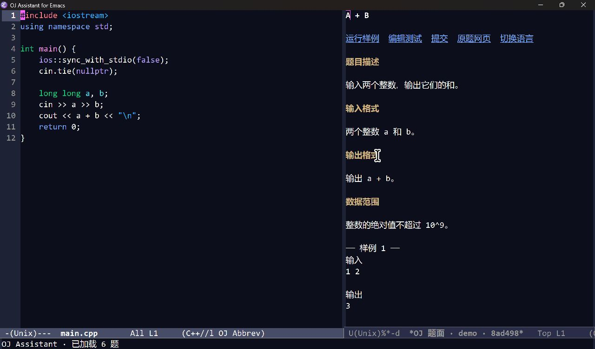
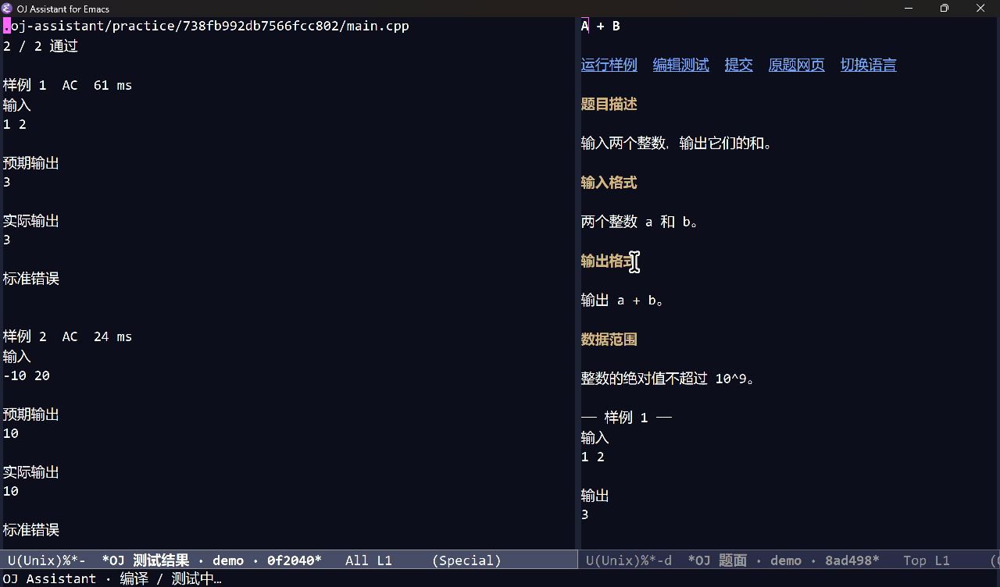
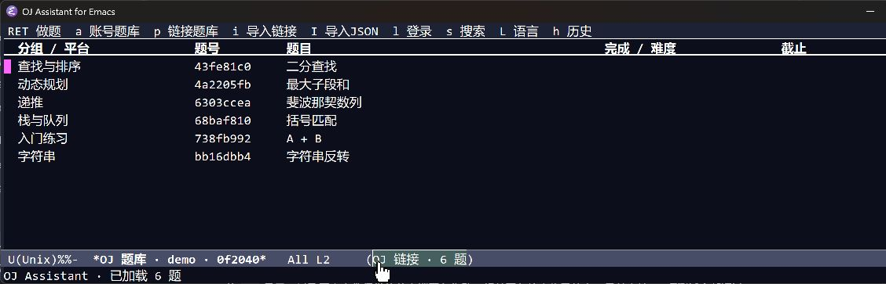

<div align="center">

# OJ Assistant for Emacs

**在 Emacs 中浏览题库、阅读题面、编写解答、运行样例和提交评测。**

[](https://github.com/ZHT0711/OJ-Assistant-Emacs/actions/workflows/test.yml)
[](https://www.gnu.org/software/emacs/)
[](https://nodejs.org/)
[](LICENSE)

Emacs Lisp 原生界面 · 题面侧窗 · 七语言本地测试 · 多平台账号

</div>

## 界面预览

### 代码与题面并排

从题库打开一道题，左侧编写解答，右侧阅读题目描述、输入输出格式和样例。题面上的按钮可以直接运行样例、编辑测试和提交。



### 样例与自定义测试

保存代码后异步编译、逐个运行测试，结果窗口列出输入、预期输出、实际输出、标准错误和耗时。



<details>
<summary>查看原生题库界面</summary>



</details>

截图使用离线演示题目，测试结果来自本机实际编译运行。

## 功能

| 功能 | 使用方式 |
| --- | --- |
| 原生题库 | `tabulated-list-mode` 列表，支持搜索、排序、分页和键盘操作 |
| 题面侧窗 | SHR 渲染中文或英文题面，展示输入输出和样例 |
| 链接导入 | 粘贴题目、公开比赛链接，或导入 Competitive Companion JSON |
| 多语言解答 | C++、C、Python、JavaScript、Java、Go、Rust 分别保存文件 |
| 本地测试 | 编译一次后运行全部样例，可编辑、增加自定义测试 |
| 账号题库 | 平台搜索、作业分组、截止日期、补交状态和完成标记 |
| 浏览器登录 | 在系统 Edge 或 Chrome 中正常登录，服务获取会话 Cookie |
| 在线提交 | 按文件类型选择平台语言，展示评测、耗时、内存和诊断信息 |
| 评测恢复 | 防止同账号同题重复上传，可停止等待并继续查询 |
| 账号复用 | Windows 使用 DPAPI 加密保存，多工作区可选择已有账号 |
| 离线缓存 | 已导入的题面、解答和测试保存在工作区，重新导入保留修改 |

## 安装

需要以下环境。

- Emacs **28.1+**，带 JSON 支持。图形版建议带 libxml2，以完整渲染 HTML 题面。
- Node.js **22.12+** 与 npm。浏览器登录依赖 Puppeteer Core 的运行环境。
- 所用语言的编译器或解释器，例如 `g++`、`python` 或 `javac`。
- 使用浏览器登录时，本机需安装 Edge 或 Chrome。

### 1. 获取代码与依赖

```sh
git clone https://github.com/ZHT0711/OJ-Assistant-Emacs.git
cd OJ-Assistant-Emacs
npm ci --ignore-scripts
```

仓库已包含平台服务源码，安装会根据锁文件获取依赖。Puppeteer Core 使用系统浏览器。

### 2. 加入 Emacs 配置

将仓库完整保留在固定目录，修改下面的 `load-path` 后加入 `init.el`。

```elisp
;; Linux / macOS 示例。Windows 可写成 "E:/OJ-Assistant-Emacs"。
(add-to-list 'load-path (expand-file-name "~/src/OJ-Assistant-Emacs"))
(require 'oj-assistant)

(global-set-key (kbd "C-c j") oj-assistant-command-map)
(add-hook 'find-file-hook #'oj-assistant-maybe-enable)
```

也可使用 `use-package`。

```elisp
(use-package oj-assistant
  :load-path "~/src/OJ-Assistant-Emacs"
  :commands oj-assistant
  :bind-keymap ("C-c j" . oj-assistant-command-map)
  :hook (find-file . oj-assistant-maybe-enable))
```

### 3. 打开刷题目录

运行 `M-x oj-assistant` 或按 `C-c j o`，选择一个保存解答的文件夹。使用 `C-u M-x oj-assistant` 可以切换到另一个目录。

首次使用可以在题库按 `I`，导入本仓库的 [`examples/practice-import.json`](examples/practice-import.json)，体验离线题面与本地测试。

## 两种刷题流程

### 链接刷题

适合跨平台练习和公开比赛。

1. 在题库按 `i`，粘贴题目或公开比赛链接。按 `I` 可以导入单题或题目数组 JSON。
2. 按 `RET` 打开题目，自动生成解答文件并显示题面。按 `L` 选择语言。
3. 编写代码，按 `C-c C-r` 运行全部测试。代码会先保存，编译和测试在后台执行。
4. 按 `C-c C-t` 编辑测试 JSON，按 `C-c C-c` 保存。每项包含字符串字段 `input` 和 `output`。
5. 按 `C-c C-s` 复制源码并打开原站提交页，在网站选择语言并提交。

| 来源 | 单题导入 | 比赛批量导入 |
| --- | --- | --- |
| Codeforces | Problemset、Contest、Gym 题目，读取失败时尝试洛谷公开镜像 | 公开 Contest / Gym |
| 洛谷 | 公开题目 | 公开比赛 |
| AtCoder | Contest Tasks，兼容部分旧版题面 | 公开比赛任务列表 |
| HDOJ | `showproblem.php?pid=...`，支持 GB18030 解码 | 通过 JSON 数组导入 |
| 其他站点 | 尝试常见 HTML 结构，也可手动 JSON 导入 | 通过 JSON 数组导入 |

需要登录、付费、报名或站点验证的页面，能否读取取决于原站权限。导入失败会列出失败链接，可改用原题网页或 JSON 导入。

### 账号题库

适合课程作业、平台题库和自动提交。

1. 在题库按 `n` 选择平台，再按 `l` 选择登录方式。
2. 浏览器登录时，在打开的 Edge 或 Chrome 中完成验证码、短信等步骤。服务获取并验证 Cookie，最长等待 5 分钟。
3. 按 `a` 加载账号题库，`s` 搜索，`>` 加载下一页，`RET` 打开题目。`f` 可直接输入题号与可选的比赛或作业 ID。
4. 运行样例后按 `C-c C-s`，选择与文件扩展名匹配的平台语言，确认后上传并等待评测。
5. 按 `C-c j h` 查看提交历史。`RET` 查看详情，`p` 停止等待，`r` 继续查询。

| backend | 平台 | 登录入口 |
| --- | --- | --- |
| `luogu` | 洛谷 | 浏览器 / Cookie |
| `leetcode` | 力扣中国站 | 浏览器 / Cookie / 平台账号 |
| `neuoj` | 东北大学 OJ | 浏览器 / Cookie |
| `csecg` | NEU CSECG 作业平台 | 浏览器 / Cookie |
| `hnuacm` | HNU ACM / ICPC OJ | 浏览器 / Cookie / 平台账号 |
| `hnucg` | HNU CourseGrading | 浏览器 / Cookie |
| `hdoj` | 杭电 OJ | 浏览器 / Cookie / 平台账号 |
| `codeforces` | Codeforces | 平台账号 |
| `fjutacm` | FJUT ACM | 平台账号 |

题库搜索和分页取决于适配器能力。Codeforces、FJUT ACM 可通过 `f` 按题号打开。CSECG 题库包含作业分组、截止时间、补交状态和历史标记。

力扣函数题需要自包含测试驱动。使用 `C-u M-x oj-assistant-run-tests` 选择带入口及待测逻辑的文件，Java 驱动使用 `Main` 类。

### 提交与继续查询

上传默认等待 30 秒，评测默认等待 120 秒。上传结果不确定或评测未结束时，同账号同题会阻止重复上传。停止本地等待后，线上评测会继续。

洛谷、NEU OJ、力扣可使用平台提交编号恢复后台进程重启后的查询。其他适配器依赖当前进程中的查询器，重启后应在原站核对记录。如果确实需要再次上传，可在原站确认记录后，在历史中按 `D` 解除阻止。

## 快捷键

### 全局前缀 `C-c j`

| 按键 | 操作 | 按键 | 操作 |
| --- | --- | --- | --- |
| `o` | 打开题库 | `p` | 显示题面 |
| `i` | 导入链接 | `I` | 导入 JSON |
| `r` | 运行测试 | `t` | 编辑测试 |
| `s` | 提交或复制源码 | `b` | 原题网页 |
| `l` | 登录 | `L` | 选择语言 |
| `h` | 提交历史 | `c` | 检查编译环境 |

### 题库与解答窗口

| 位置 | 按键 | 操作 |
| --- | --- | --- |
| 题库 | `RET` / `s` / `g` | 打开题目 / 搜索 / 刷新 |
| 题库 | `a` / `p` | 账号题库 / 链接题库 |
| 题库 | `n` / `l` / `A` | 初始化平台 / 登录 / 使用已保存账号 |
| 题库 | `>` / `f` / `d` | 下一页 / 按题号打开 / 移除链接题目 |
| 解答 | `C-c C-r` | 保存并运行测试 |
| 解答 | `C-c C-t` | 编辑测试 |
| 解答 | `C-c C-s` | 提交 |
| 解答 | `C-c C-o` | 显示题面 |
| 测试编辑器 | `C-c C-c` | 校验并保存 JSON |

## 配置工具链

默认从 Emacs 的 `exec-path` 与进程 `PATH` 中查找工具。可用 `C-c j c` 检查当前语言的环境，也可以指定完整路径。

```elisp
(setq oj-assistant-default-language "cpp"
      oj-assistant-time-limit 2
      oj-assistant-statement-width 0.42)

;; 按自己的安装位置修改。路径带空格时保持原样。
(setq oj-assistant-node-command "C:/Program Files/nodejs/node.exe"
      oj-assistant-tools
      '((cpp . "C:/msys64/ucrt64/bin/g++.exe")
        (c . "C:/msys64/ucrt64/bin/gcc.exe")
        (python . "C:/Python/python.exe")
        (node . "C:/Program Files/nodejs/node.exe")))
```

| 语言 | 标准 / 入口 | 工具配置键 |
| --- | --- | --- |
| C++ | C++17 | `cpp` |
| C | C11 | `c` |
| Python | Python 3 | `python` |
| JavaScript | Node.js | `node` |
| Java | `Main`，UTF-8 编译 | `javac`、`java` |
| Go | 单文件程序 | `go` |
| Rust | Rust 2021 | `rust` |

每道链接题记忆自己的语言，不同语言使用独立的 `main.*` 文件。编译超时为 60 秒，默认每项测试限时 2 秒，运行输出上限为 1 MiB。结果按空白分词比较。交互题、自定义判题器和需要浮点容差的题目应使用原站评测。本地代码以当前用户权限执行。

## 数据与凭据

工作区数据保存在所选刷题目录。

```text
.oj-assistant/
├── practice/<key>/          链接题面、测试、语言记录和 main.*
├── emacs.json               平台与账号引用
├── emacs-problems/<key>/    账号题面缓存及自定义测试
├── emacs-sources.json       解答文件与题目的关联
└── emacs-history.json       提交编号、评测状态和诊断信息
```

Windows 账号库位于 `~/.oj-assistant-emacs/accounts.dpapi`，使用当前 Windows 用户的 DPAPI 加密，保存时验证解密回读。按 `A` 可在其他工作区复用已保存账号。浏览器配置保存在同一用户目录的 `browser/` 下。其他系统使用进程内账号库，后台服务退出后需重新登录。

链接缓存与 OJ Assistant Plus 的 `.oj-assistant/practice/` 格式兼容。已有 `.ojassistconfig.json` 可提供兼容的平台设置，VS Code SecretStorage 中的账号需在 Emacs 中重新登录。重新导入题目会保留已有代码与自定义测试，从列表移除题目也会保留文件。

## 常见问题

<details>
<summary>提示找不到 Node.js 或编译器</summary>

在 Emacs 中检查 `(executable-find "node")` 或 `(executable-find "g++")`。从桌面启动 Emacs 时，环境变量可能与终端不同。可以通过 `oj-assistant-node-command` 和 `oj-assistant-tools` 指定完整路径。Windows 下也要让编译器依赖的 DLL 所在目录出现在进程 `PATH` 中。

</details>

<details>
<summary>导入时出现验证页，或账号会话过期</summary>

先在原站确认该题目公开可读。账号题库可按 `l` 重新登录，公开链接题可改用 JSON 导入。Cookie 过期后需刷新会话，原站权限、验证码和报名要求仍然适用。

</details>

<details>
<summary>题面中的公式和图片如何显示</summary>

当前题面使用 Emacs SHR 渲染。数学公式保留源码文本，图片可通过原题网页查看。缺少 libxml2 的 Emacs 会退回显示题面 HTML。

</details>

## 开发与验证

界面由 `oj-assistant.el` 实现。`bridge.cjs` 是独立 Node.js 服务，以逐行 JSON 与 Emacs 通信，复用 `src/` 中的平台、解析器和运行器代码。

```sh
npm ci --ignore-scripts
npm run check:elisp
npm test
```

也可以分别运行后端和 Emacs ERT 测试。

```sh
npm run test:backend
npm run test:emacs
```

测试涵盖中文路径、缓存互通、语言切换、实际 C++ / JavaScript 执行、超时与输出限制、账号隔离、防重复上传、停止等待、重启恢复和 Windows DPAPI。账号网络流程使用模拟适配器验证，真实账号登录与在线提交仍需逐平台验证。平台服务改动、站点验证和页面结构变化可能需要更新适配器。

## 来源与许可

本项目基于 OJ Assistant Plus 的平台与链接刷题模块开发，新增 Emacs 原生界面、进程通信、工作区集成和独立安装方式。代码采用 MIT 许可，上游版权与第三方说明随仓库保留。

- [OJ Assistant Plus](https://github.com/ZHT0711/OJ-Assistant-Plus)
- [OJ Assistant](https://github.com/lss233/OJ-Assistant)
- [第三方说明](THIRD_PARTY_NOTICES.md)
- [MIT License](LICENSE)
